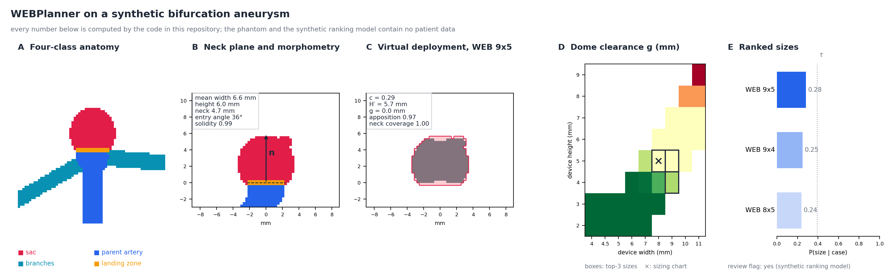
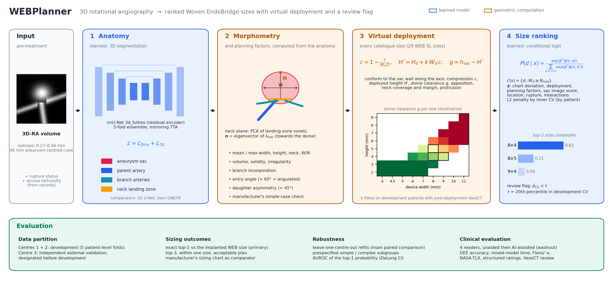

<div align="center">

# WEBPlanner

**AI planning of Woven EndoBridge size from 3D rotational angiography**

[](#citation)
[](pyproject.toml)
[](#anatomy-network)
[](#tests)
[](LICENSE)

<sub>3D-RA · neck landing zone · virtual deployment · conditional logit · external validation · reader study</sub>

<p align="center">
  <a href="#method">Method</a> · <a href="#architecture">Architecture</a> · <a href="#quick-start">Quick start</a> · <a href="#workflow">Workflow</a> · <a href="#documentation">Documentation</a> · <a href="#citation">Citation</a>
</p>

</div>

<p align="center">
  
</p>

Cooperating with the Chinese PLA General Hospital (First and Sixth Medical Centers) and the PLA Air Force Medical
Center, we develop WEBPlanner, a decision-support pipeline that turns a pre-treatment 3D rotational angiogram into a
ranked list of Woven EndoBridge (WEB) sizes. It segments the aneurysm and its neck, measures the anatomy and the
planning factors operators weigh, virtually deploys every catalogue size and ranks the sizes with a conditional logit
model, flagging low-confidence cases for expert review.

## At a glance

| Input | Core model | Outputs | Evaluation |
|:---|:---|:---|:---|
| Pre-treatment 3D-RA · rupture status · access tortuosity | nnU-Net 3D segmentation · PCA neck plane · geometric deployment · conditional logit | Top-3 WEB sizes with probabilities · review flag · morphometry · planning factors · deployment rehearsal | Independent external centre · leave-one-centre-out · four-reader clinical evaluation |

| Centres | Device catalogue | External validation | Clinical evaluation |
|:---:|:---:|:---:|:---:|
| **3** (2 development + 1 external) | **29 WEB SL sizes** (4 to 11 mm × 2 to 9 mm) | **held out before development** | **4 readers**, unaided then AI-assisted |

## Method

**1. Anatomy.** A 3D segmentation network (nnU-Net configuration, five-fold ensemble) is trained with the loss
$`\mathcal{L}=\mathcal{L}_{\mathrm{Dice}}+\mathcal{L}_{\mathrm{CE}}`$ to delineate the aneurysm sac, parent artery,
branch arteries and the **neck landing zone**, the ostial surface on which the proximal end of the device sits. The
neck plane passes through the landing-zone centroid; its normal $`\mathbf{n}`$ is the eigenvector of the smallest
eigenvalue of the landing-zone covariance, oriented towards the dome.

**2. Morphometry and planning factors.** Mean and maximum width, height, neck width, width-to-neck ratio, volume,
solidity and branch incorporation; the entry angle between the terminal parent artery and the aneurysm axis, the
daughter-vessel take-off asymmetry, and the manufacturer's simple-case check.

**3. Virtual deployment.** Every catalogue size $`d`$ (nominal width $`W_d`$, height $`H_d`$) is placed on the
landing zone along the sac axis and conformed to the sac wall:

```math
c = 1-\frac{\bar{r}}{W_d/2}, \qquad H' = H_d + k\,W_d\,c, \qquad g = h_{\mathrm{sac}} - H'
```

with lateral compression $`c`$, deployed height $`H'`$, elongation coefficient $`k`$ (fitted on post-deployment
VasoCT) and dome clearance $`g`$, plus wall apposition, neck coverage and margin, protrusion and a fluoroscopic
rehearsal of the deployment stages.

**4. Size ranking.** Over the feasible sizes $`\mathcal{C}(x)=\{d: W_d \ge N_{\max}\}`$,

```math
P(d \mid x)=\frac{\exp\left(\beta^{\mathrm{T}}\phi(x,d)\right)}{\sum_{d' \in \mathcal{C}(x)} \exp\left(\beta^{\mathrm{T}}\phi(x,d')\right)}
```

where $`\phi`$ holds the deviation from the sizing-chart size, the deployment outputs, planning factors, a sac image
score, location, rupture status and their interactions; the L2 penalty is chosen by patient-grouped inner
cross-validation.

**5. Review flag.** Cases whose top-1 probability falls below $`\tau`$, the 20th percentile in development
cross-validation, are flagged for expert review.

## Architecture

<p align="center">
  
</p>

## Results

The results of the three-centre study are reported in the accompanying article, which is under peer review, and are
not reproduced here. The repository contains no clinical data and no weights trained on patient images; all figures
on this page are produced by the code on synthetic phantoms.

## Quick start

```bash
git clone https://github.com/ZhWenPrism/WEBPlanner.git
cd WEBPlanner
pip install -e ".[deep,viz,dev]"          # core: NumPy/SciPy/scikit-learn/statsmodels; deep: PyTorch, MONAI, SimpleITK
pytest                                     # unit and integration tests on synthetic phantoms
webplanner demo --out outputs/demo         # synthetic cohort -> splits -> ranker -> locked model -> external evaluation -> report
webplanner demo --segmentation             # also trains the segmentation network for a few iterations (PyTorch)
```

The demo writes a planning report such as `outputs/demo/run/reports/<case>_plan.md` with the top-3 sizes, their
virtual deployment, the sizing-chart size, the anatomy and the review flag.

## Workflow

| Step | Command | Output |
|:---|:---|:---|
| Partition | `webplanner split` | external centre, 5 patient-level folds, leave-one-centre-out folds |
| <a id="anatomy-network"></a>Anatomy network | `webplanner export-nnunet` + `nnUNetv2_train ... -tr nnUNetTrainerWEBPlanner`, or `webplanner train-seg` | fold checkpoints |
| Segmentation | `webplanner predict-seg` | 4-class label maps (ensemble + mirroring) |
| Anatomy | `webplanner analyze` | neck frame, morphometry, planning factors |
| Elongation | `webplanner fit-elongation` | $`k`$ with bootstrap CI |
| Deployment | `webplanner deploy` | 29 virtual deployments per case |
| Ranking | `webplanner train-ranker` / `--loco` | locked model with checksums / LOCO predictions |
| External validation | `webplanner evaluate` | agreement, chart comparison, AUROC, subgroups |
| Clinical evaluation | `webplanner reader-study` | GEE, mixed models, Fleiss' κ, bootstrap differences |
| Planning | `webplanner plan` | JSON + Markdown report for one case |

Details: [docs/TRAINING.md](docs/TRAINING.md) · configuration: [`configs/`](configs) · data format:
[docs/DATA_INTERFACE.md](docs/DATA_INTERFACE.md).

## Codebase blueprint

```text
WEBPlanner/
├── assets/                         # architecture and graphical abstract (generated by scripts/)
├── configs/
│   ├── data/                       # cohort layout, external centre, folds, resampling
│   ├── device/                     # WEB 17 SL selection table (29 sizes)
│   ├── model/                      # segmentation (nnU-Net / native) and planner settings
│   └── experiment/                 # development, leave-one-centre-out, clinical evaluation, smoke test
├── docs/                           # architecture, data interface, training, evaluation protocol, model card
├── webplanner/
│   ├── types.py                    # shared dataclasses and the label map
│   ├── config.py                   # typed YAML configuration with overrides
│   ├── data/
│   │   ├── dicom.py                # Philips 3D-RA series (stacks and enhanced multi-frame)
│   │   ├── preprocessing.py        # isotropic resampling, 40 mm crop, fold-wise normalisation
│   │   ├── splits.py               # external centre, patient-level folds, LOCO, leakage checks
│   │   ├── transforms.py           # 3D augmentation (rotation, scaling, elastic, intensity, mirroring)
│   │   ├── dataset.py              # foreground-oversampled patch dataset
│   │   ├── nnunet_export.py        # nnU-Net v2 raw dataset + splits_final.json
│   │   ├── cohort.py               # cohort manifest <-> case records
│   │   └── synthetic.py            # bifurcation-aneurysm phantoms with ground truth
│   ├── segmentation/
│   │   ├── networks/               # residual U-Net (nnU-Net style), 3D U-Net, Swin-UNETR
│   │   ├── losses.py               # Dice + CE, deep supervision
│   │   ├── trainer.py              # SGD Nesterov, poly LR, AMP, EMA model selection, checkpoints
│   │   ├── inference.py            # Gaussian sliding window, mirroring TTA, fold ensemble
│   │   ├── postprocess.py          # connected components, landing-zone constraints
│   │   └── nnunet_trainer.py       # nnUNetTrainerWEBPlanner
│   ├── geometry/                   # neck plane, vessel origins, centrelines, morphometry, planning factors
│   ├── device/                     # catalogue, sizing chart, virtual deployment, elongation fit, rehearsal
│   ├── ranking/                    # features, conditional logit, grouped CV / nested CV / LOCO, review flag, image score
│   ├── evaluation/                 # Dice/HD95, Wilson/McNemar/Newcombe, ICC/Bland-Altman/kappa, DeLong, reader study
│   ├── pipeline/                   # per-case analysis, ranker development, locked model, reports
│   └── cli/                        # `webplanner` command
├── scripts/                        # figure generation
├── tests/
│   ├── unit/
│   └── integration/
└── README.md
```

## Tests

| Suite | Tests | Checks |
|:---|:---:|:---|
| `test_core.py` | 17 | catalogue and sizing chart, phantoms, patient-level splits and leakage guards, preprocessing, configuration |
| `test_geometry.py` | 53 | neck plane, widths, height, neck, entry and take-off angles, solidity against analytic phantom truth |
| `test_deployment.py` | 16 | equation (1), height cap, dome clearance, neck coverage, elongation fit, rehearsal rendering |
| `test_ranking.py` | 14 | likelihood gradient, coefficient recovery, feasible set, grouped CV without patient overlap, LOCO, review flag |
| `test_segmentation.py` | 15 | networks, deep supervision, Dice + CE, training and checkpoints, sliding window, post-processing |
| `test_transforms_dataset.py` | 27 | augmentation consistency, patch sampling, nnU-Net export |
| `test_evaluation.py` | 16 | statistics against statsmodels, scikit-learn and published examples |
| `test_pipeline.py` | 2 | development, locking, tamper detection, external planning, leave-one-centre-out |

PyTorch tests are skipped automatically where PyTorch is not installed.

## Documentation

[Architecture](docs/ARCHITECTURE.md) · [Data interface](docs/DATA_INTERFACE.md) · [Training](docs/TRAINING.md) ·
[Evaluation protocol](docs/EVALUATION_PROTOCOL.md) · [Model card](docs/MODEL_CARD.md) ·
[Reproducibility](docs/REPRODUCIBILITY.md) · [Release scope](docs/RELEASE_SCOPE.md)

> **Research use only.** WEBPlanner is not a medical device. Its outputs are proposals for review by qualified
> neurointerventionalists and must be checked against the anatomy before any clinical use. The device table is a
> transcription for research and must be verified against the instructions for use in force.

<a id="citation"></a>

<details>
<summary><b>Citation</b></summary>

The accompanying article is under peer review. Until it is published, please cite the software:

```bibtex
@software{wen2026webplanner,
  title   = {WEBPlanner: AI planning of Woven EndoBridge device size from 3D rotational angiography},
  author  = {Wen, Zhihong},
  year    = {2026},
  version = {0.1.0},
  url     = {https://github.com/ZhWenPrism/WEBPlanner}
}
```

</details>
